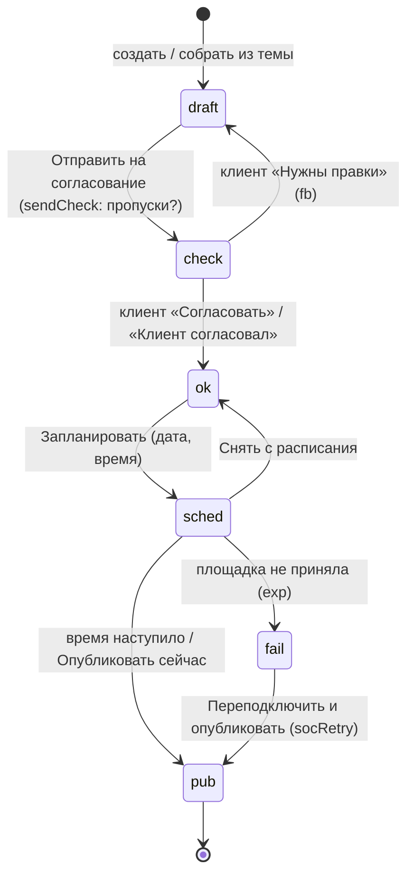
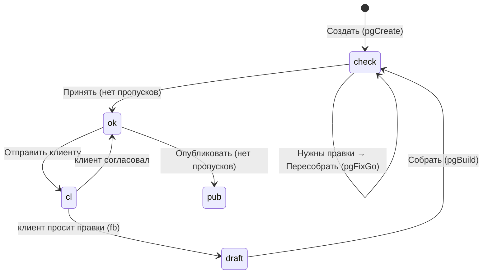

# Модель данных

Выведено из JS-массивов `prototype.html`. Названия полей — как в прототипе (короткие), рядом — смысл. Для бэкенда **(предложение)**: человекочитаемые имена колонок, UUID вместо ключей-названий, `created_at/updated_at` у всех сущностей. Поля вида `upd:'сегодня'`, `d:'4 сен'`, `ts:5` в прототипе — отображаемые строки и порядок сортировки; на бэкенде это `timestamp`.

Важно: в прототипе **ключ клиента — его короткое название** (`p:'Вита'`), ключ страницы — её название (`PAGES.n`), ссылки кампании на страницу — тоже по названию (`mix.page`). На бэкенде везде нужны ID.

## 1. Каркас: кабинет → клиенты → всё остальное

```mermaid
erDiagram
  USER ||--o{ MEMBERSHIP : "состоит"
  CABINET ||--o{ MEMBERSHIP : "команда"
  CABINET ||--o{ CLIENT : "ведёт"
  CABINET ||--|| BALANCE : "баланс Maker"
  CABINET ||--o{ JOURNAL_ENTRY : "списания/пополнения"
  CABINET ||--o{ CRM_CONNECTION : "финансы агентства"
  CLIENT ||--|| STYLE : "стиль+тон"
  CLIENT ||--o{ STYLE_VERSION : "история"
  CLIENT ||--o{ VOICE_SOURCE : ""
  CLIENT ||--o{ FACT : ""
  CLIENT ||--o{ AUDIENCE : ""
  CLIENT ||--o| STRATEGY : "одна"
  CLIENT ||--o{ PLAN_ITEM : "темы"
  CLIENT ||--o{ PUBLICATION : ""
  PLAN_ITEM ||--o{ PUBLICATION : "th"
  CLIENT ||--o{ SERIES : ""
  SERIES ||--o{ SHOT : ""
  SHOT ||--o{ VIDEO : "первый кадр"
  CLIENT ||--o{ BANNER_SET : ""
  CLIENT ||--o{ PAGE : ""
  CLIENT ||--o{ DECK : ""
  CLIENT ||--o{ CAMPAIGN : ""
  CAMPAIGN ||--o{ CAMPAIGN_DAY : "цифры по дням"
  CAMPAIGN }o--o{ AUDIENCE : "groups"
  CAMPAIGN }o--o| PAGE : "mix.page"
  CAMPAIGN }o--o| BANNER_SET : "mix.bn"
  CAMPAIGN }o--o| VIDEO : "mix.video"
  CLIENT ||--o{ CONNECTION : "соцсети и карты"
  CLIENT ||--o{ INBOX_ITEM : ""
  CLIENT ||--o| SHARE_LINK : "ссылка для клиента"
  CLIENT ||--o| BRIEF : "вопросы клиенту"
  CABINET ||--o{ CHAT : ""
  CHAT }o--o| CLIENT : "p (может быть пусто)"
  CABINET ||--o{ NOTIFICATION : ""
```

- **Кабинет** принадлежит владельцу; участники команды видят всех клиентов кабинета (в прототипе нет доступа по клиентам — open-questions).
- **Клиент** — корень почти всех данных. Удаление клиента удаляет всё его (см. `delClient()`), кроме журнала.
- Не фильтруются по клиенту: баланс, лимиты, журнал (но у записи есть клиент), команда, профиль.
- **Текущий клиент** — состояние интерфейса (`localStorage mk-client`). **(предложение)** хранить на сервере как пользовательскую настройку, чтобы совпадало между устройствами.

## 2. Пользователь, кабинет, команда

**User** (`PF`, `AU`): `name`*, `last`, `role` (Агентство / Фрилансер / Маркетолог в компании — «Вы работаете»), `email`, `phone`, `ya` (привязан Яндекс ID), `pw` (пароль задан), `pwd` (когда задан), `photo`, `tz` (часовой пояс), `persona` (показывать персонажей, сейчас `localStorage mk-persona`).
Вход: код на почту/SMS (4 цифры, 3 попытки, блок 10 мин, повтор через 45 с), пароль (от 8 символов, только если задан), Яндекс ID. Последний способ входа отвязать нельзя.

**Session**: `id`, `d` (устройство · браузер), `w` (город), `t` (последняя активность), `me`.

**Cabinet**: `name` (`CAB`, например «Агентство «Север»»; у нового — из знакомства или «Мой кабинет»), реквизиты для документов (`bl-docs`: юрлицо, ИНН), `deleted_at` (удаление через 14 дней с отменой).

**Membership** (`PF.team`): `id`, `n` имя, `e` почта, `r` роль, `pend` (приглашён, ещё не принял), `me`.

| Роль `r` | В UI | Что может (из `PF_ROLES`) |
|---|---|---|
| `own` | Владелец | всё, включая оплату и участников |
| `edit` | Редактор | создаёт и правит материалы, отправляет клиентам; оплату не видит |
| `view` | Просмотр | только смотрит материалы и отчёты |
| `buh` | Бухгалтер | только «Оплата и документы» и закрывающие документы |

Клиенты по ссылке мест не занимают и ролей не имеют. Кто видит «Финансы и клиенты», может ли редактор тратить баланс — не решено (open-questions).

**NotificationSettings** (`PF.ntf`): матрица событие × канал `[почта, Telegram]`: `appr` (клиент согласовал/правки), `bal` (баланс ниже порога), `render` (готов ролик/долгая сборка), `week` (сводка за неделю), `news`. Плюс `tg` (бот подключён), `quiet` (тихие часы). В кабинете уведомления показываются всегда.

## 3. Клиент и бренд

**Client** (`PROJECTS`): `n` полное название («Вита · сеть клиник»), `s` короткое (ключ в прототипе), `m` подпись (источник стиля / сайт), `img` обложка, `stat` статус карточки (`work` В работе / `draft` Черновик / `pause` На паузе / `done` Завершен — семантика не определена, open-questions), `avs` аватары команды. При создании: `name`* + `link` (сайт или соцсеть, необязательно) → создаётся стиль по умолчанию (цвета Maker).
Связанные настройки клиента **(предложение — собрать в одну таблицу)**: `autoReport` (`AUTO_REP[клиент]`), рекламодатель для маркировки (`ADV[клиент]`, например «ООО «…»»), ниша (сейчас угадывается из текста `niche()`).

**Style** (`DESIGN[клиент]`), версионируется целиком:

| Поле | Тип | Смысл |
|---|---|---|
| `v` | int | номер версии |
| `src`, `at` | string, date | откуда снят стиль (сайт, брендбук, готовый набор), когда |
| `col.primary/deep/accent/ink/bg/surface` | hex | цвета по ролям (`ROLES`) |
| `btn` | `light` \| `accent` | цвет кнопок |
| `font.h`, `font.t` | string | шрифт заголовков и текста (`FONTS`; бывают без кириллицы/веб-версии → «показываем заменой») |
| `radius` | int px | скругление |
| `density` | Компактная / Обычная / Свободная | |
| `tone.formal`, `tone.emo` | 0–100 | голос: дружелюбно↔официально, сдержанно↔эмоционально |
| `say[]` | `[так говорим, так не говорим]` | правила голоса |
| `photo.light/color/comp/avoid` | string | манера фото |
| `refs[]` | shot id, ≤3 | эталонные кадры |
| `logo` | file | |
| `hist[]` | `{v, d, t, ch}` | история: версия, дата, что изменилось, снимок для отката |

Сохранение = новая версия; откат = тоже новая версия (`stSave()`, `stRollback()`). При сохранении баннеры клиента в статусе «Работает» уходят на повторную модерацию (`BSETS.st: pub → proc`).

**VoiceSource** (`VOICE[клиент].src`): `u` ссылка/название, `k` (`own` наш канал / `like` пишем как этот / `text` статья), `n` пометка. **VoiceHistory**: `{d, t}`.

**Fact** (`FACTS`): `id`, `p` клиент, `cat` ∈ `FACT_CATS` (О компании, Цены и условия, Адреса и время, Цифры и результаты, Акции, Запреты, Из ответов), `t` текст*, `src` (сайт, прайс, вы, отчёт, кейс, рассказ, клиент, чат поста, имя файла), `d`. Правится в списке; категория угадывается (`faGuess()`).

**Audience** (`GROUPS`): `id`, `p`, `n` название*, `slug` (для адреса варианта страницы `?g=slug`), `who`, `task`, `matters[]`, `obj[]` возражения, `words`, `geo`, `age`, `interests`, `offer`, `keys[]` поисковые фразы, `sugg` (предложена Maker, ждёт «Принять/Отклонить»), `why` (почему предложена), `fromTxt`. Неизвестное — плашкой `[гео]`. `ws/wl` — демо-веса для разнесения расхода и заявок кампании по аудиториям (open-questions).

**Gap (пропуск)** — не хранится, вычисляется: все `[…]` в стратегии, темах и публикациях клиента (`faGaps()`). Ответ = замена во всех материалах + факт «Из ответов».

## 4. Контент

**Strategy** (`STRATS[клиент]`, одна на клиента):
`st` статус, `per` период словами («на 3 месяца»), `ver`, `upd`, `goal`, `kpi[] = [название, значение]`, `pos` позиционирование, `msgs[]` главные мысли, `ch[] = [площадка, роль, частота]` (площадки: `vk tg ig tc li yt story`), `rub[] = [рубрика, доля %, описание]` (сумма 100%), `fb` текст правок клиента, `cl` решение клиента, `brief` накопленный текст рассказов, `tuned = {b, w, x, dv, prev, d}` сдвиг долей по результатам публикаций (с откатом).

**PlanItem** (`PLAN`): `id`, `p`, `d` дата (`YYYY-MM-DD`), `rub` рубрика из стратегии, `t` название, `idea` главная мысль, `facts[]` (неизвестное — плашкой), `img`, `st`, `fb`, `cl`. Собранные из темы публикации ссылаются на неё (`SOC.th`); тема без публикаций = «ждёт сборки» (`plMade()`).

**Publication** (`SOC`, `type` ∈ `post car story clip`):

| Поле | Смысл |
|---|---|
| `id, type, p, t` | id, формат, клиент, заголовок/тема |
| `st` | статус (см. §8) |
| `date, time` | когда выйдет (в прототипе строки «завтра», «15 окт») |
| `plats[]` | площадки: `vk tg ig tc li` (для клипа `vk ig yt`) |
| `cur, idx` | UI: текущая площадка, слайд/кадр |
| `img` | картинка поста / обложка |
| `text{площадка: string}` | версия текста под площадку (`post`) |
| `var{площадка: 0/1}` | выбранный вариант текста |
| `slides[{h,s}]` | карусель: обложка … призыв |
| `frames[{h,s,img,stk}]` | сторис: кадры, `stk` — стикер-ссылка |
| `scenes[{t,d,img}]`, `dur`, `rendered` | клип: раскадровка, длительность, отрендерен |
| `n` | кол-во слайдов/кадров при создании |
| `th` | id темы плана |
| `src[]` | вложения, на которые опирались |
| `fb`, `cl` | правки клиента, решение клиента (`ok`/`fix`) |
| `fail{pl, why}` | сбой публикации |
| `vers[{text, plats, note}]`, `chat[]` | версии и чат поста (только `post`) |

Правила площадок — `SOC_FMT` (пропорция, размер, лимит знаков, хэштеги, «что видно до "ещё"», безопасные зоны сторис/клипов, макс. слайдов). Превышение лимита — «длиннее на N знаков» + «Сократить», не обрезать молча.

## 5. Медиа, баннеры, страницы, колоды

**Series** (`SERIES`): `id`, `t`, `p`, `d`, `model` (внутреннее, в UI не показываем), `sw[]` палитра, `own` (свои фото). Служебные серии: «Из чата» (`c-клиент`), «Для публикаций» (`gen-клиент`), «Свои фото» (`o-клиент`).
**Shot** (`SHOTS`): `id`, `s` серия, `t`, `img`, `st`, `pr` промпт, `f` формат («1:1 · 2K»), `cost`, `why` (причина брака / что переснято), `alt`.
**Video** (`VIDEOS`): `id`, `t`, `p`, `shot` первый кадр*, `st`, `prog` %, `dur` 5/10/15 с, `model` (режим: быстрее/реалистичнее/плавнее — `VD_MODE`), `fm[]` 9:16/1:1/16:9, `pr`, `mv` движение камеры, `cost`.

**BannerSet** (`BSETS`): `id`, `n`, `p`, `st`, `bg` (`''` светлый фон бренда / `'#brand'` градиент / url кадра), `adv` рекламодатель, `erid`, `vars[{h,s,c}]` 1–3 варианта (заголовок, подзаголовок, кнопка), `v` текущий, `off[]` выключенные форматы (индексы `FMTS`: 4 VK + 6 Директ), `why` причина отклонения, `warn` добавлено обязательное предупреждение, `cost`.

**Page** (`PAGES`): `n` название (ключ!), `p`, `st`, `url`, `img`, `groups[[название, slug]]` версии под аудитории, `goal` (Заявки/Звонки/Запись/Продажа), `brief` текст задачи, `h` заголовок, `fb`, `fixed` (правки, по которым пересобрали), `cl`. Контент страницы в прототипе вычисляется (`pgContent()`), не хранится — на бэкенде нужен блочный контент.
**Site** (`SITES`): `p`, `dom` домен (свой или `*.maker.site`), `ck{Домен, HTTPS, Метрика, Коллтрекинг: ok|wait|off}`.

**Deck** (`DECKS`): `id`, `t`, `p`, `type` (Отчёт совету / Отчёт команде / Питч клиенту / Отчёт клиенту за месяц / Отчёт по результатам), `st`, `outline[]` план, `slides[]`, `src[]`, `share{code, when, total, t[] секунд на слайд}`, `auto` собрана сама, `rev` ждёт проверки перед отправкой, `mon` месяц отчёта.
**Slide** (`S()`): `l` макет (`cover section bullets stat chart image`), `h`, `b[]` тезисы, `n` заметки докладчику, `alt{h,b}` вариант, `data[[метка, число]]` для графика, `img`, `num`.

**Template** (`TPLS`): `id`, `type` (`kit page banner deck camp post`), `n`, `niche`, `own` (свой, сохранён из работы), `p`, `prompt`, плюс поля по типу (`blocks`, `vars`, `slides`, `groups`; у набора `kit` — `cost`, `items`, `page`, `bn`, `imgs`, `camp`, `budget`, `goal`, `ask`, `warn`). У своих шаблонов страниц — цифры из результатов (`tpStats()`), у системных — нет.

## 6. Реклама, результаты, финансы

**Campaign** (`CAMPS`): `id`, `n`, `p`, `ch` (VK Реклама / Яндекс Директ), `st`, `from`, `to`, `pausedAt`, `budget` ₽, `goal{v, t}` (t: заявок/записей/звонков/продаж — в разных единицах не складываем), `groups[]` (названия аудиторий), `mix{page, bn, video, shots[]}`, `miss[]` дни без внесённых цифр, `ask` исходная задача, `cpl` ожидаемая цена заявки, `mul`. `b{sp,cpc,cr,sale,chk,ctr}` и `spike` — параметры генератора демо-цифр, на бэкенде не нужны.
**CampaignDay** (`DAYS`): `c`, `d`, `sp` расход, `cl` клики, `imp` показы, `ld` заявки, `sl` продажи, `rev` выручка. Расход/клики/заявки — сейчас вручную (`enSave()`); продажи и выручка — после сверки с CRM (`CRM.until`).
**CrmReconciliation** (`CRM`, `CRM_DIS`): `until` дата сверки, `file`, спорные оплаты `{d, v, w причина, ok}`.
**PostStat** (`SST`, демо): `p, d, rub, pl, t, reach, re реакции, cm комментарии, sv сохранения`. Главная мера — реакции на 1 000 охвата по рубрикам.

**Finance** (`FIN`, на кабинет): `cash` касса, `fixed[[день, сумма, статья]]`, `cl{клиент: {fee гонорар/мес, day день оплаты, st ok|wait|late, late дней}}`, `conn{crm: {id, acc, d, pipe воронка, paid этап «оплачено»}}`, `src` первая подключённая, `manual.d`. `SEASON[клиент]` — 12 коэффициентов (демо). CRM: `amo b24 mgp sheet` (`CRMS`), только чтение.

**JournalEntry** (`JOURNAL`): `d`, `tm`, `p` клиент или `—`, `sec` раздел («Публикации», «Фото и видео», …, `topup`), `act` описание, `v` сумма (минус — списание). Баланс = сумма `v`.
**Limits** (`LIMITS`): `confirm` порог подтверждения ₽ (0/5/10/20), `month` лимит в месяц (0/1000/3000), `low` предупреждать, `lowAt` порог (200 ₽), `auto` автопополнение (на 1 000 ₽ картой).

## 7. Коммуникации

**Connection** (`CONN[клиент][площадка]`): `n` название сообщества/канала, `u` адрес, `d` когда подключено, `mode` (`auto` публикуем сами / `remind` присылаем напоминание), `exp` дата истечения доступа. Площадки: `vk tg tc ig li yt gis ym` (`CONN_PL`). `connAuto()` = `mode==='auto' && !exp`.
**InboxItem** (`INBOX`): `id`, `p`, `pl`, `kind` (`comment` / `dm` / `review`), `post` к какому посту, `who`, `at`, `txt`, `tag` (`q` вопрос / `bad` жалоба / `ok` отзыв / `spam`), `ask` (`price`/`time` — о чём вопрос), `stars` (1–5, отзывы с карт), `st` (`new` / `done` / `hidden`), `draft` черновик ответа, `alt`, `reply`, `when`, `ans` заготовка пропуска.
**Rating** (`RATING[клиент][gis|ym]`): `[оценка, число отзывов]`.
**ShareLink** — ссылка для клиента `maker.app/c/xxxxxx`, одна на клиента, показывает всё, что ждёт его решения (`cvPending()`). **Brief** (`BRIEF[клиент]`): `qs[]` вопросы (пропуски, на которые клиент может ответить, ≤6), `ans{}`, `d`, `done`, `n`.
**DeckShare** — `maker.site/d/<code>`, просмотры по слайдам.

**Chat** (`CHATS`): `id`, `t`, `p` (может быть пусто — «Без клиента»), `general` (отвечать в общем), `ctx[]` контекст (Стиль и тон, Сайт, Страницы, Кампании и результаты), `cost` потрачено, `msgs[]`, `pend`. Особый чат `id:'dk'` — общий чат кабинета (колонка). **Message**: `r` (`me`/`ai`/`sys`), `x` текст, `h` HTML ответа, `att[]`, `ag` агент, `acts[]` (`plan post banners page shot`), `link[подпись, действие]`, `shot`, `pick` (спросить клиента), `qs[]/ans{}/qi` уточняющие вопросы, `basis/ctxSnap`.
**StarterKit** (`PACKS`, `PK`): `id`, `p`, `text`, `files`, `pick{strat,plan,post:N,car,story,bn,page,deck}`, `items[{k, st wait|run|done, refs[], meta}]`, `chat[]`, `st` new|run|done, `cost`, `conf` расхождения цен, `await`.

**Notification** (`NTF`): `id`, `p` (пусто = общее), `k` (`ok fix bad info team money ready`), `t`, `s`, `at`, `read`, цель перехода. **ReminderDismissal** (предложение; сейчас `TD_HIDE` в памяти по тексту): ключ напоминания, `snoozed_until` / `done`.

## 8. Статусы и переходы

### Публикация (`SOC_ST`)


Клип: `draft` (раскадровка) → «Рендерить» → `check` (`socRender()`). Повторная отправка клиенту стирает `fb`. Метки: draft Черновик, check На согласовании, ok Согласован, sched Запланирован, pub Опубликован, fail Не вышел.

### Стратегия (`STR_ST`) и тема плана (`PL_ST`)
`draft → check → ok`; `check → draft` с `fb` (правки клиента); тема: `ok/check → draft` («Вернули в черновик»). Пересборка стратегии → новая `ver`, статус `draft`, заполненное не трогаем.

### Страница (`PG_ST`)

Метки: draft Черновик, check Ждёт проверки, ok Принята, cl На согласовании, pub Опубликована.

### Кадр (`SH_ST`) и ролик (`VD_ST`)
Кадр: `check` Ждёт проверки → `pub` Принят; `check|pub → redo` Переснят (платно, по замечанию); `bad` Не получился → `redo` (бесплатно); `own` Своё фото (загружено). Ролик: `proc` Рендерится (прогресс) → `check` → `pub` Принят; `check → proc` (переснять).

### Комплект баннеров (`BN_ST`)
`draft → proc` На модерации (обязателен erid) → `pub` Работает | `bad` Отклонён площадкой (`why`) → «Исправить» → `proc`. `pub → proc` при смене стиля клиента.

### Кампания (`CM_ST`)
`draft → run` Запустить (баннеры не на модерации и не отклонены) ↔ `pause` (`pausedAt`); `done` Завершена — в демо-данных есть, перехода в коде нет (по дате окончания — предложение). Удалять `run` нельзя.

### Колода (`DK_ST`)
`check` План ждёт проверки → `pub` Готова (сборка). Автоотчёт: создаётся `pub` с `auto, rev=true` → «Отправить клиенту» → `rev=false`.

### Входящее (`INBOX.st`) и отзыв
`new → done` (ответ отправлен или скопирован, нельзя с `[…]`); `new|done → hidden` (Скрыть, с «Вернуть»); `tag: spam ↔ q` («Это не спам»).

### Сообщение чата
`me`; `ai` с `typing` (печатает…) → готовый ответ; если в ответе пропуски — `qs` и шаги `qi` до конца вопросов; `sys` — служебные строки (смена клиента, статуса).

### Прочее
Подключение: нет → `auto|remind` → `exp` (истёк) → переподключено. Приглашение: `pend` → принято. Стартовый набор: `new → run → done`, пункты `wait → run → done`. Бриф: создан → `done`.
